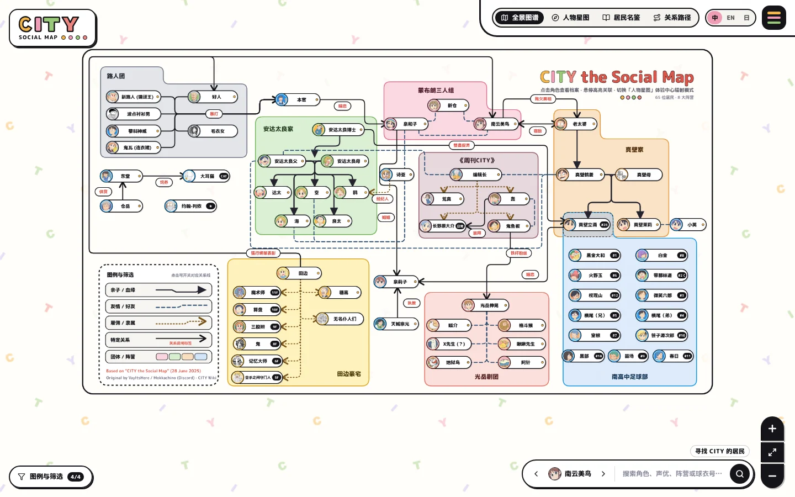
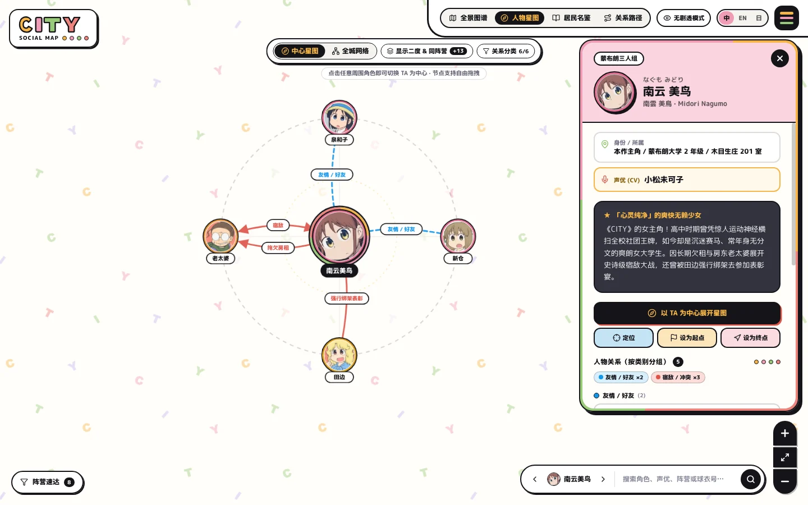

<div align="right">English | <a href="./README.zh.md">简体中文</a></div>

<div align="center">


# CITY Social Map

Interactive character relationship map and ego-network explorer for ***CITY THE ANIMATION*** (*Kyoto Animation*, 2025) & Keiichi Arawi's ***CITY***.

[](LICENSE)
[](https://github.com/chius-n/city-social-map/actions/workflows/deploy.yml)


[Live Demo](https://social.city.chius.dev) · [Ego Radar](https://social.city.chius.dev/#mode=network&char=nagumo) · [CITY Avatar](https://avatar.city.chius.dev) · [Issues](https://github.com/chius-n/city-social-map/issues) · [Awesome CITY](https://github.com/chius-n/awesome-citytheanimation)

</div>

> "This town is not just a normal town. There's laughter, love, and emotional moments."
>
> 65 Residents · 8 Factions · 65 Relationship Edges · 中文 / EN / 日本語

**CITY Social Map** turns the wonderfully chaotic social web of Keiichi Arawi's *CITY* into an interactive, trilingual web canvas inspired by [`city-the-animation.com`](https://city-the-animation.com/) — explore every connection across the classic panorama chart or switch to a character-centric radial radar.

Live site: **https://social.city.chius.dev**





## Features

- **Panorama Social Map**: Covers all **65 residents**, **8 factions** (including the **Makabe Family ∩ CITY South Soccer Team** overlap at Tatewaku Makabe and isolated *John Lennon*), and **65 canon relationship lines** with portrait medallions, interactive layer filters, and story tooltips on every link.
- **Character Ego Radar & Full Network**: Switch into **Ego Radar** mode to place any resident at the center with a 4-color C-I-T-Y aura ring, curved semantic links, optional 2nd-degree & same-faction outer rings (`+N`), free node dragging, or switch to the **Full Network** view where node size reflects connection degree with 6-category filtering (*Family*, *Friendship*, *Crush / Romance*, *Work & Ties*, *Rivalry & Chaos*, *Mentor & Fans*) and **Isolate Subgraph** spotlighting.
- **Character Dossiers & Resident Directory**: Every resident features a portrait avatar (with clickable preview), canonical **中文 / EN / 日本語** names, verified 2025 anime voice cast (58 voiced CVs), iconic taglines, one-click **Open in Ego Radar**, and relationships grouped cleanly by category.
- **Six Degrees of CITY (Path Finder)**: Discover the shortest relationship chain between any two residents with avatar breadcrumb trails — including the canonical *John Lennon* isolation Easter egg.
- **Official Visual Aesthetic**: Features the 4-color C-I-T-Y palette, scrolling confetti canvas, rotating `conic-gradient` frames, 4-stripe morphing menu button, and instant search across names, CVs, factions, and jersey numbers.

## Quick Links

| View / Target | URL | Description |
| --- | --- | --- |
| Classic Social Map | [`/`](https://social.city.chius.dev/) | Full 65-resident panorama with relationship layer toggles |
| Character Dossier | [`/#char=wako`](https://social.city.chius.dev/#char=wako) | Flies straight to Wako Izumi and opens her portrait dossier |
| Ego Radar | [`/#mode=network&char=nagumo`](https://social.city.chius.dev/#mode=network&char=nagumo) | Centers the interactive star radar on Midori Nagumo |
| Full Network | [`/#mode=network&sub=full`](https://social.city.chius.dev/#mode=network&sub=full) | Displays all 65 residents in a degree-sized, faction-clustered network |

## Development

Node.js 22+ is required.

```bash
npm install
npm run dev      # Start local dev server (http://localhost:5173)
npm run build    # Type-check & build for production
```

## Credits & Sources

- **Original Social Map**: [File:CITY Social Map by VayItsHere.jpeg](https://city.wiki.gg/wiki/File:CITY_Social_Map_by_VayItsHere.jpeg) by **VayItsHere / Mokkachino (Discord)** (June 28, 2025) on [CITY Wiki](https://city.wiki.gg/).
- **Curated Resources**: [`chius-n/awesome-citytheanimation`](https://github.com/chius-n/awesome-citytheanimation).
- **Sister Project**: [`chius-n/city-avatar`](https://github.com/chius-n/city-avatar) ([`avatar.city.chius.dev`](https://avatar.city.chius.dev)).
- **Visual Style Reference**: [*CITY THE ANIMATION* Official Website](https://city-the-animation.com/).
- **Cast & Localization References**: Official anime credits, [Bangumi](https://bgm.tv/subject/514358), [AniList](https://anilist.co/anime/181841/CITY-THE-ANIMATION), and [Moegirlpedia](https://zh.moegirl.org.cn/CITY).

## 📄 License

Software source code in this repository is distributed under the [MIT License](LICENSE).

Unofficial fan-made interactive tribute. Original *CITY* characters, anime portraits, and intellectual property belong to © Keiichi Arawi · Kodansha / *CITY THE ANIMATION* Production Committee (Kyoto Animation).

---

<div align="center">
  <sub>Crafted with ❤️ by <a href="https://chius.cc">Chius</a> · Powered by Cloudflare & GitHub</sub>
</div>
