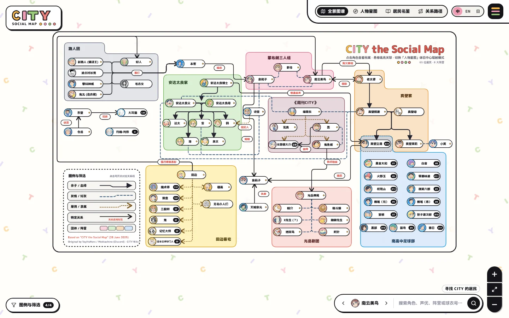
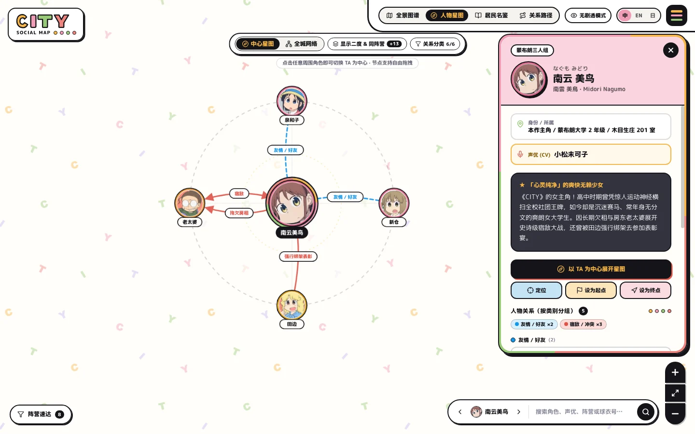

<div align="right"><a href="./README.md">English</a> | 简体中文</div>

<div align="center">


# CITY Social Map · 《小城日常》人物关系图

《CITY THE ANIMATION》（小城日常，京都动画 2025）交互式全角色关系图谱与人物星图探索站。

[](LICENSE)
[](https://github.com/chius-me/city-social-map/actions/workflows/deploy.yml)


[在线体验](https://social.city.chius.dev) · [人物星图](https://social.city.chius.dev/#mode=network&char=nagumo) · [问题反馈](https://github.com/chius-me/city-social-map/issues) · [Awesome CITY](https://github.com/chius-me/awesome-citytheanimation)

</div>

> “这座城市，绝非寻常之地。有欢笑、有爱、也有热泪盈眶的瞬间。”
>
> 65 位居民 · 8 大阵营 · 65 条人物关系 · 中文 / EN / 日本語





## 核心特性

- **双模式交互视图**：
  - **全景图谱**：忠实还原画师 VayItsHere 的完整 65 人 / 8 阵营拓扑布局（含真壁立涌同时横跨「真壁家 ∩ CITY 南高中足球部」的交叠区域，以及游离全城之外的约翰·列侬彩蛋），并为每个胶囊节点镶嵌阵营配色圆形头像。
  - **人物星图 & 全城网络**：支持以任意角色为中心的 **Ego Radar 中心辐射星图**（四色 C-I-T-Y 中心光环、语义彩色弧线与方向箭头、可选开启「二度 & 同阵营」外环 `+N」、点击周围头像无缝切换中心、自由拖拽与重置布局），以及节点大小按关联度动态缩放的 **全城网络**（支持 6 大关系分类筛选与「仅看关联子图」）。
- **全员 65 位角色头像与权威中文译名**：收录全员裁切优化的 `.webp` 头像（`public/avatars/`），覆盖全景图谱、星图节点、档案抽屉（支持点击放大预览）、居民名鉴、搜索联想和路径面包屑；译名与 58 位动画声优（CV）对照官方资料、Bangumi 与萌娘百科逐一校对（如泉和子、老太婆、鬼鱼板、大耳猫等）。
- **分类归纳的漫画风角色档案**：致敬官网旋转四色 `conic-gradient` 边框与 `#33333F` 评论气泡，展示身份、声优、名台词、一键 **「以 TA 为中心展开星图」**，并按 **家庭 / 血缘**、**友情 / 好友**、**恋爱 / 暗恋**、**雇佣 / 隶属**、**宿敌 / 冲突**、**师生 / 粉丝** 分组统计呈现关联人物与关系梗概。
- **六度小城 · 关系路径查找**：基于 BFS 计算任意两位居民间的最短关系链与头像轨迹（附带约翰·列侬隔离彩蛋）。
- **无剧透模式**：顶部与菜单栏支持一键开启无剧透模式，自动隐藏《日常》联动身份及后期揭晓本名（猜谜王、蓼科神威、鬼瓦、权现山等）。
- **官方视觉语言 & 三语切换**：视觉与动效参考 [`city-the-animation.com`](https://city-the-animation.com/)，支持 **中文 / EN / 日本語** 实时切换。

## 直达链接

| 视图 / 目标 | URL | 说明 |
| --- | --- | --- |
| 全景图谱 | [`/`](https://social.city.chius.dev/) | 查看 65 位居民完整关系拓扑与关系图层开关 |
| 角色档案卡片 | [`/#char=wako`](https://social.city.chius.dev/#char=wako) | 自动定位至「泉和子」并打开右侧人物档案 |
| 人物星图（Ego Radar） | [`/#mode=network&char=nagumo`](https://social.city.chius.dev/#mode=network&char=nagumo) | 以「南云美鸟」为中心展开辐射星图 |
| 全城网络 | [`/#mode=network&sub=full`](https://social.city.chius.dev/#mode=network&sub=full) | 按关联度缩放节点并按阵营聚类的全城关系网 |

## 项目结构

```text
city-social-map/
├── public/
│   ├── avatars/                      # 全员 65 位角色圆形适配 WebP 头像
│   └── favicon.svg                   # 四色 C-I-T-Y 徽标
├── src/
│   ├── components/
│   │   ├── CharacterNetworkCanvas.tsx # 人物星图（Ego Radar）与全城网络画布
│   │   ├── SocialMapCanvas.tsx       # 经典全景图谱平移/缩放画布
│   │   ├── DetailDrawer.tsx          # 四色旋转边框角色档案与分组关系卡
│   │   ├── DirectoryModal.tsx        # 可筛选的 65 位居民名鉴
│   │   ├── PathFinderBar.tsx         # 六度小城关系路径查找栏
│   │   ├── TopBar.tsx                # 官网风斜角顶栏、视图与无剧透开关
│   │   ├── BottomControls.tsx        # 底部角色快切、即时搜索与缩放药丸组
│   │   └── MenuOverlay.tsx           # 全屏四色菜单与精选资料索引
│   ├── data/                         # 角色、阵营、关系边、三语文案与资料库
│   ├── styles/                       # 官网 C-I-T-Y 色板与动效样式
│   └── utils/                        # BFS 路径查找与无剧透展示工具
├── wrangler.jsonc                    # Cloudflare Workers Static Assets 配置
└── .github/workflows/deploy.yml      # GitHub Actions CI 检查与自动部署
```

## 本地开发

需要 Node.js 22+。

```bash
npm install
npm run dev      # http://localhost:5173
npm run build    # TypeScript 类型检查 + 生产构建 (dist/)
npm run preview  # 本地预览生产构建产物
```

## 部署

站点托管于 **Cloudflare Workers Static Assets**，已绑定自定义域名 [social.city.chius.dev](https://social.city.chius.dev)（`wrangler.jsonc` 启用 `not_found_handling: "single-page-application"`）。

推送至 `main` 分支将触发 [`.github/workflows/deploy.yml`](.github/workflows/deploy.yml) 自动构建并上线；Pull Request 会运行 `npm run build` 与 `npx wrangler deploy --dry-run` 校验。

GitHub Actions 仓库 Secrets：

1. `CLOUDFLARE_API_TOKEN`（**必填**）：使用 **Edit Cloudflare Workers** 模板创建的 API Token。
2. `CLOUDFLARE_ACCOUNT_ID`（**推荐**）：目标 Cloudflare Account ID。

如需本地直接部署：

```bash
npx wrangler login
npm run deploy
```

## 数据来源与致谢

- **原始关系图拓扑**：[File:CITY Social Map by VayItsHere.jpeg](https://city.wiki.gg/wiki/File:CITY_Social_Map_by_VayItsHere.jpeg)，由社区作者 **VayItsHere / Mokkachino (Discord)** 于 2025 年 6 月创作并发布于 [CITY Wiki](https://city.wiki.gg/)。
- **精选资料索引**：[`chius-me/awesome-citytheanimation`](https://github.com/chius-me/awesome-citytheanimation)。
- **视觉风格致敬**：[《CITY THE ANIMATION》官方网站](https://city-the-animation.com/)。
- **译名与声优参考**：动画官方制作人员表、[Bangumi 番组计划](https://bgm.tv/subject/514358)、[AniList](https://anilist.co/anime/181841/CITY-THE-ANIMATION) 与 [萌娘百科](https://zh.moegirl.org.cn/CITY)。

## 📄 许可证

本项目软件源代码采用 [MIT 许可证](LICENSE) 开源。

本项目为非官方粉丝致敬与资料整理作品。原作《CITY》及《CITY THE ANIMATION》角色设定、动画肖像及相关版权归 © あらゐけいいち・講談社／CITY THE ANIMATION 製作委員会所有。

---

<div align="center">
  <sub>Crafted with ❤️ by <a href="https://chius.cc">Chius</a> · Powered by Cloudflare & GitHub</sub>
</div>
